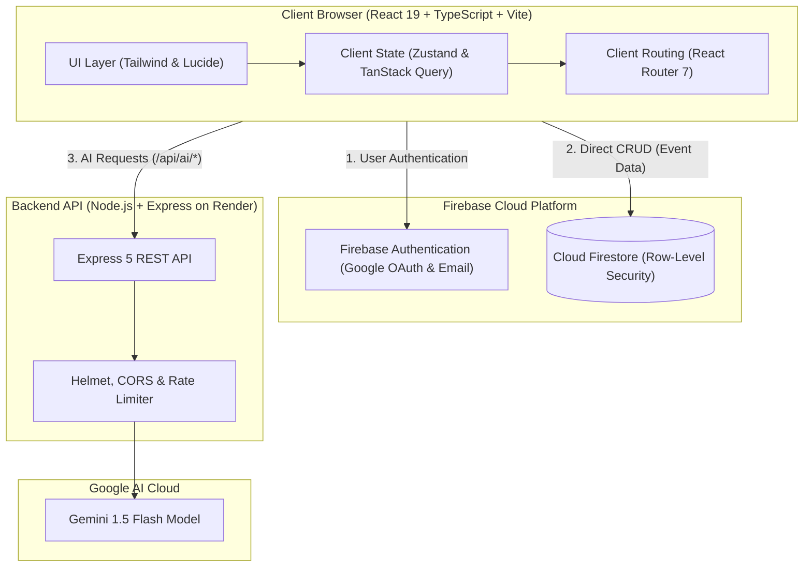

# Planen AI

> **AI-Powered Celebration & Event Planner**

Planen AI is an intelligent full-stack event planning web application that transforms celebration concepts into structured, actionable execution plans. Leveraging Google Gemini AI alongside Firebase and Express, Planen AI automates event budgeting, chronological milestone scheduling, guest RSVP coordination, vendor management, and creative theme generation from an intuitive, modern dashboard.

[](https://promptwars-5-client.vercel.app/)
[](https://github.com/bahathraheel/PROMPTWARS-5)
[](https://opensource.org/licenses/MIT)

**Live Application:** [promptwars-5-client.vercel.app](https://promptwars-5-client.vercel.app/) *(Production deployment: [planen-ai.vercel.app](https://planen-ai.vercel.app/))*  
**Backend API:** [planen-ai1.onrender.com](https://planen-ai1.onrender.com)

---

## Application Previews

<div align="center">

### Landing & Discovery


<br/>

| Secure Authentication | Seamless Onboarding |
| :---: | :---: |
|  |  |
| *Google OAuth & Email Authentication* | *Account Registration & Profile Setup* |

</div>

> [!NOTE]
> Additional authenticated dashboard, budget, timeline, vendor, and guest management screenshots can be captured and placed into `docs/screenshots/` after signing in.

---

## Key Features

- **AI Event Blueprint Generation**: Leverages Google Gemini 1.5 Flash to automatically compose end-to-end event schedules, suggested category budgets, and initial vendor checklists from basic event parameters.
- **Budget & Expense Tracking**: Real-time expense tracking with category allocations, spent vs. remaining totals, and visual charts powered by Recharts.
- **Timeline & Milestone Schedules**: Chronological milestone management with status tracking (Pending, In Progress, Completed), priority levels, and due dates.
- **Guest List Management**: Complete guest roster with RSVP tracking (Attending, Declined, Tentative), plus-one support, dietary notes, and CSV import/export.
- **Vendor Directory**: Manage service providers (venues, caterers, photographers, entertainment) with contact details, hired statuses, and quote notes.
- **Theme Studio**: Aesthetic moodboards, curated color palettes, and decor concepts tailored to the event vibe.
- **Export Center**: Export event blueprints, financial breakdowns, and guest summaries to CSV and PDF for easy offline distribution.
- **Secure Authentication**: Firebase Authentication with Google Sign-In popup and Email/Password authentication.

---

## Tech Stack

### Frontend (`/client`)
- **Core**: React 19, TypeScript (~6.0), Vite 8
- **Routing**: React Router 7
- **State Management**: Zustand 5, TanStack Query 5
- **Forms & Validation**: React Hook Form 7, Zod 4
- **UI & Styling**: Tailwind CSS, Lucide Icons
- **Data Visualization**: Recharts 3
- **Document Export**: PapaParse, jsPDF, html2canvas
- **Testing & Quality**: Vitest, React Testing Library, Oxlint

### Backend (`/server`)
- **Runtime**: Node.js (>=20), Express 5
- **AI Integration**: Google Generative AI SDK (`@google/generative-ai`), Gemini 1.5 Flash
- **Security & Utilities**: Helmet, CORS, Express Rate Limit, Morgan, Dotenv

### Cloud & Database
- **Database**: Google Cloud Firestore (NoSQL database with row-level security rules)
- **Client Auth**: Firebase Authentication (Google OAuth + Email/Password)
- **Frontend Hosting**: Vercel
- **Backend Hosting**: Render

---

## Architecture

The following diagram illustrates the interaction between client, backend server, Firebase cloud services, and the Google Gemini AI engine:



---

## Local Development Setup

### Prerequisites
- **Node.js** >= 20.x
- **npm** >= 9.x
- A **Firebase Project** with Authentication and Cloud Firestore enabled
- A **Google Gemini API Key** from [Google AI Studio](https://aistudio.google.com/)

### 1. Clone the Repository
```bash
git clone https://github.com/bahathraheel/PROMPTWARS-5.git
cd PROMPTWARS-5
```

### 2. Configure Environment Variables

#### Backend (`server/.env`)
Copy `server/.env.example` to `server/.env`:
```bash
cp server/.env.example server/.env
```
Populate the configuration values:
- `PORT` (e.g. `3001`)
- `NODE_ENV` (`development`)
- `GEMINI_API_KEY` (Your Google Gemini AI Studio key)
- `GEMINI_MODEL` (`gemini-1.5-flash`)
- `ALLOWED_ORIGINS` (`http://localhost:5173,http://localhost:3000`)
- `RATE_LIMIT_WINDOW_MS` (`900000`)
- `RATE_LIMIT_MAX` (`100`)

#### Frontend (`client/.env.local`)
Copy `client/.env.example` to `client/.env.local`:
```bash
cp client/.env.example client/.env.local
```
Populate the configuration values:
- `VITE_API_BASE_URL` (`http://localhost:3001`)
- `VITE_FIREBASE_API_KEY`
- `VITE_FIREBASE_AUTH_DOMAIN`
- `VITE_FIREBASE_PROJECT_ID`
- `VITE_FIREBASE_STORAGE_BUCKET`
- `VITE_FIREBASE_MESSAGING_SENDER_ID`
- `VITE_FIREBASE_APP_ID`
- `VITE_FIREBASE_MEASUREMENT_ID`
- `VITE_DEMO_MODE` (`false`)

### 3. Install Dependencies
```bash
# Install root, client, and server dependencies
npm run install:all
```

### 4. Run Locally
```bash
# Start both backend server and frontend client concurrently
npm run dev
```

The services will be available at:
- Frontend: `http://localhost:5173`
- Backend API: `http://localhost:3001`
- Health check: `http://localhost:3001/api/health`

### 5. Running Tests & Quality Checks
```bash
# Run unit and component test suites (115 passing tests)
npm test

# Run linter
npm run lint

# Build client for production
npm run build
```

---

## Deployment

### Frontend (Vercel)
- **Deployment Platform**: Vercel
- **Root Directory**: `client`
- **Build Command**: `npm run build`
- **Output Directory**: `dist`
- **Environment Variables**: Add all `VITE_*` configuration keys in the Vercel Project Settings. Ensure `VITE_API_BASE_URL` points to your deployed backend URL.

### Backend (Render)
- **Deployment Platform**: Render Web Service
- **Root Directory**: `server`
- **Build Command**: `echo 'No build step required'`
- **Start Command**: `node src/index.js`
- **Environment Variables**: Configure `GEMINI_API_KEY`, `ALLOWED_ORIGINS`, `NODE_ENV=production`, and `PORT`.

### Database & Security (Firebase)
- Cloud Firestore security rules are maintained in [`firestore.rules`](./firestore.rules) ensuring users can only read and write their own event records.
- Composite query indexes are defined in [`firestore.indexes.json`](./firestore.indexes.json).

---

## Project Purpose & License

Planen AI was developed to demonstrate a production-ready modern full-stack web application integrating generative AI capabilities into end-to-end event and celebration logistics.

This project is licensed under the [MIT License](https://opensource.org/licenses/MIT).
