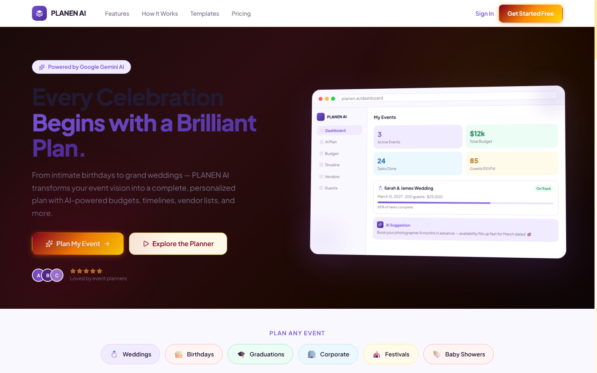
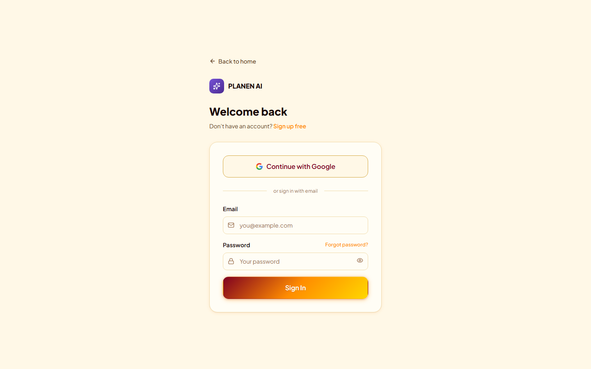
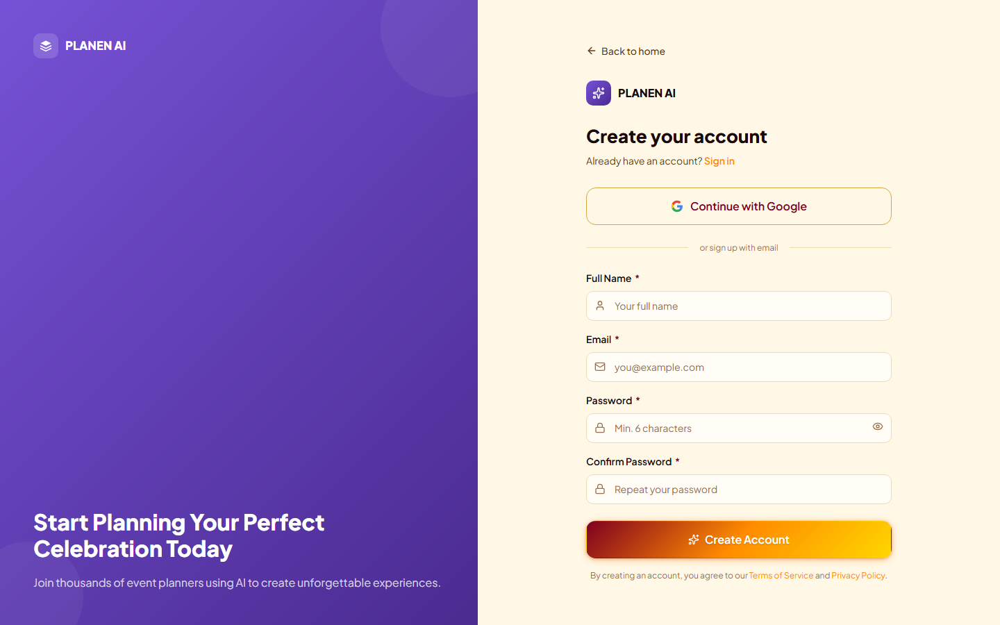
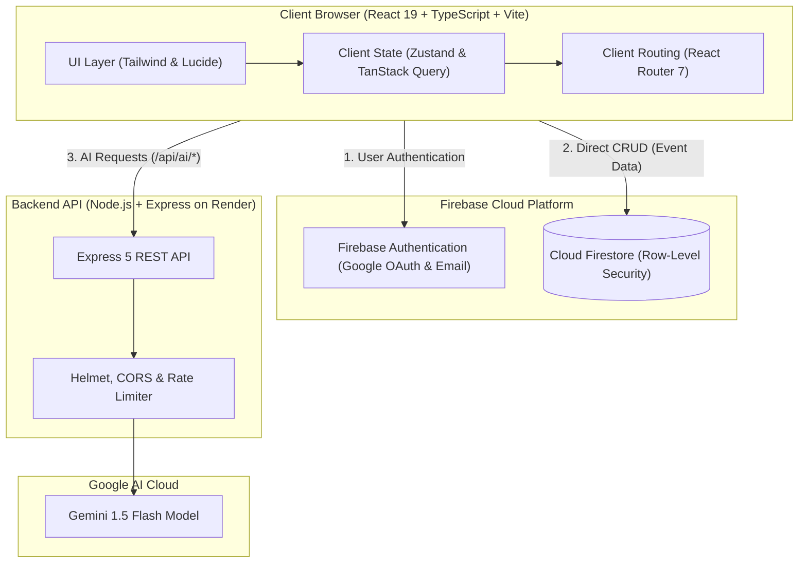

# Planen AI

> **AI-Powered Celebration & Event Planner**

Planen AI is an intelligent full-stack event planning web application that transforms celebration concepts into structured, actionable execution plans. Leveraging Google Gemini AI alongside Firebase and Express, Planen AI automates event budgeting, chronological milestone scheduling, guest RSVP coordination, vendor management, and creative theme generation from an intuitive, modern dashboard.

**Live Application:** [promptwars-5-client.vercel.app](https://promptwars-5-client.vercel.app/) *(Production deployment: [planen-ai.vercel.app](https://planen-ai.vercel.app/))*  

---

## Application Previews

### Landing & Discovery

 

| Secure Authentication | Seamless Onboarding |
| :---: | :---: |
|  |  |
| *Google OAuth & Email Authentication* | *Account Registration & Profile Setup* |

> [!NOTE]
> Additional authenticated dashboard, budget, timeline, vendor, and guest management screenshots can be captured and placed into `docs/screenshots/` after signing in.

---

## Key Features

- **AI Event Blueprint Generation**: Leverages Google Gemini 1.5 Flash to automatically compose end-to-end event schedules, suggested category budgets, and initial vendor checklists from basic event parameters.
- **Budget & Expense Tracking**: Real-time expense tracking with category allocations, spent vs. remaining totals, and visual charts powered by Recharts.
- **Timeline & Milestone Schedules**: Chronological milestone management with status tracking (Pending, In Progress, Completed), priority levels, and due dates.
- **Guest List Management**: Complete guest roster with RSVP tracking (Attending, Declined, Tentative), plus-one support, dietary notes, and CSV import/export.
- **Vendor Directory**: Manage service providers (venues, caterers, photographers, entertainment) with contact details, hired statuses, and quote notes.
- **Theme Studio**: Aesthetic moodboards, curated color palettes, and decor concepts tailored to the event vibe.
- **Export Center**: Export event blueprints, financial breakdowns, and guest summaries to CSV and PDF for easy offline distribution.
- **Secure Authentication**: Firebase Authentication with Google Sign-In popup and Email/Password authentication.

---

## Tech Stack

### Frontend (`/client`)
- **Core**: React 19, TypeScript (~6.0), Vite 8
- **Routing**: React Router 7
- **State Management**: Zustand 5, TanStack Query 5
- **Forms & Validation**: React Hook Form 7, Zod 4
- **UI & Styling**: Tailwind CSS, Lucide Icons
- **Data Visualization**: Recharts 3
- **Document Export**: PapaParse, jsPDF, html2canvas
- **Testing & Quality**: Vitest, React Testing Library, Oxlint

### Backend (`/server`)
- **Runtime**: Node.js (>=20), Express 5
- **AI Integration**: Google Generative AI SDK (`@google/generative-ai`), Gemini 1.5 Flash
- **Security & Utilities**: Helmet, CORS, Express Rate Limit, Morgan, Dotenv

### Cloud & Database
- **Database**: Google Cloud Firestore (NoSQL database with row-level security rules)
- **Client Auth**: Firebase Authentication (Google OAuth + Email/Password)
- **Frontend Hosting**: Vercel
- **Backend Hosting**: Render

---

## Architecture

The following diagram illustrates the interaction between client, backend server, Firebase cloud services, and the Google Gemini AI engine:

---

This project is licensed under the [MIT License](https://opensource.org/licenses/MIT).
